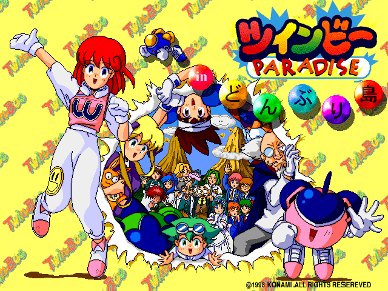

# Software Archaeology of TwinBee PARADISE in Donburi Island 
>This project is a work-in-progress and still is actively being documented.

A research project examining the game Windows 95 game *TwinBee PARADISE in Donburi Island*, built in Macromedia/Adobe Director. This research covers how the first disc of the game works internally, what it needs to run, and how it can be preserved. 

## What This Project Covers
This research looks at how the first disc operates in terms of code, logic, and
the environments it can run on. Topics include:

- Reverse Engineering of the projector and its Lingo scripts 
- Software archaeology and preservation
- Environment dependencies (operating system, display, Xtras, video codecs)
- Flowcharts of the code, events, and game structure

## Table of Contents 
- [1. Overview](Docs/overview.md#1-overview)
- [2. About the Software](Docs/about_the_software.md#2-about-the-software) 
    - [2.1 Why it Matters For Preservation](Docs/about_the_software.md#21-why-it-matters-for-preservation)
    - [2.2 Technical Specifications/Issues](Docs/about_the_software.md#22-technical-specificationsissues)
- [3. Methodology (Not Started)]()
- [4. Research Questions (Not Started)]()
- [5. Environment Setup (Not Started)]()
- [6. File Formats (Not Started)]()
- [7. Software/Tools (Not Started)]()
- [8. How the EXE/Projector Operates (Not Started)]()
- [9. Starting the Game (Not Started)]()
- [10. Lingo Code Events (Not Started)]()
- [11. Working in Different Environments (Not Started)]()

## Important Notice 
This repository does not include any files from the original game. The docs will only
include screenshots from the game, original written analysis, and short code
excerpts relevant to the research. Only modified files will be uploaded to this repository. 

This project is for preservation and educational purposes. *TwinBee PARADISE in Donburi Island*, and the TwinBee
name and characters are the intellectual property of Konami. All trademarks and copyrights belong to Konami Group Corporation and their respective owners.

## Usage of AI/LLM Disclosure 
Claude AI is used to help break down how Lingo works in Director, from syntax to
the events used in the files. No AI-generated code is implemented in the game or
used to modify its files. AI is used only to aid understanding of the logic and code structure.

## Contributing
Contributions are welcome and very much appreciated. Helpful areas include testing
on different Windows versions or emulators, editing/adding notes, and proofreading. 
